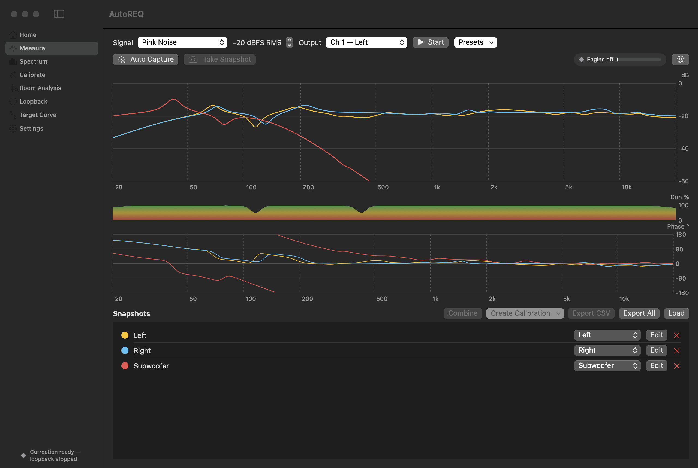
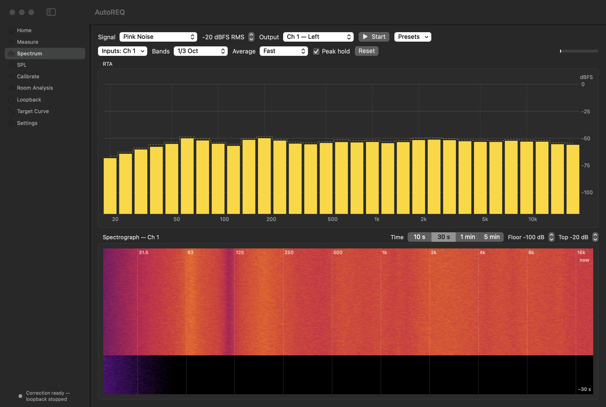
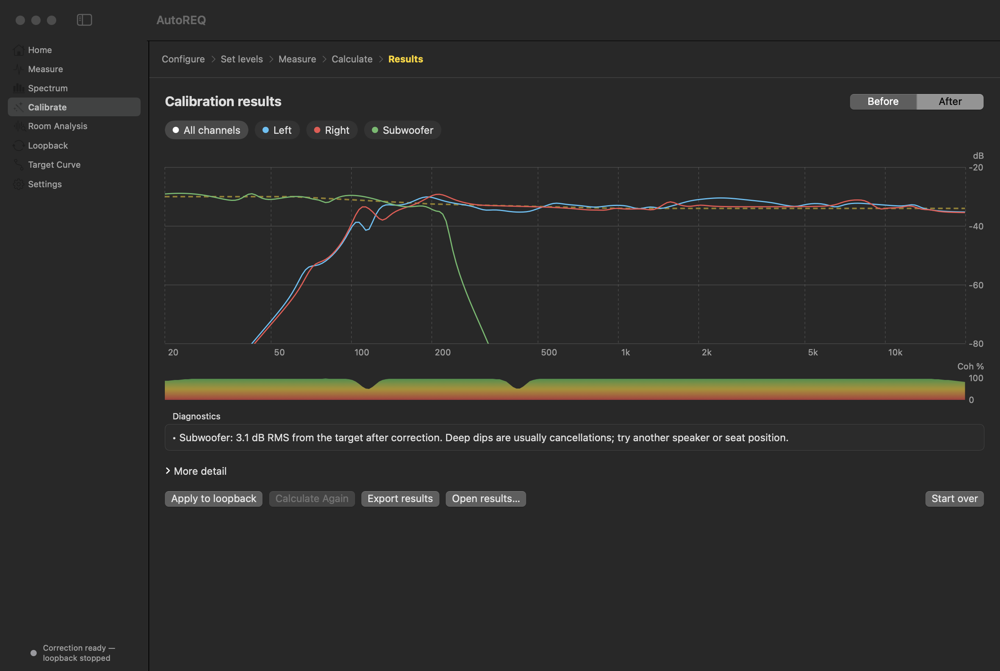
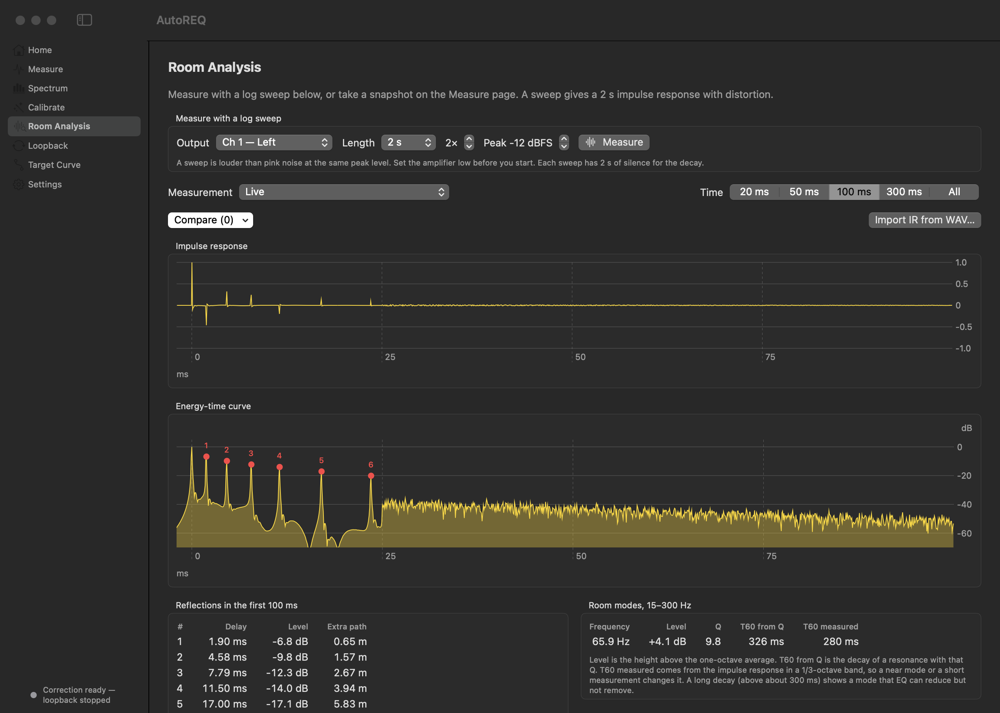
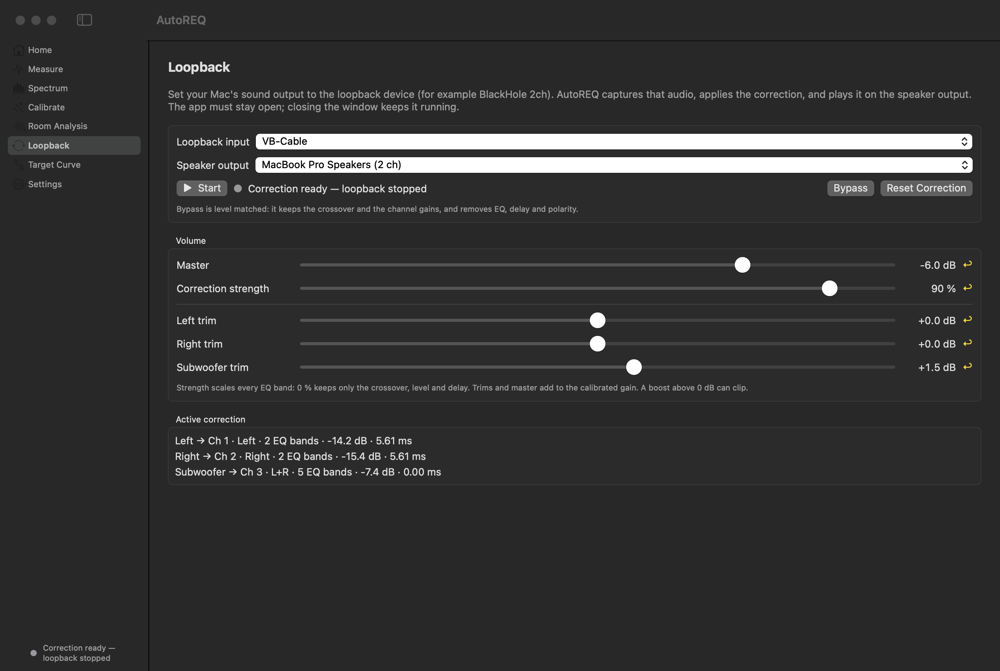
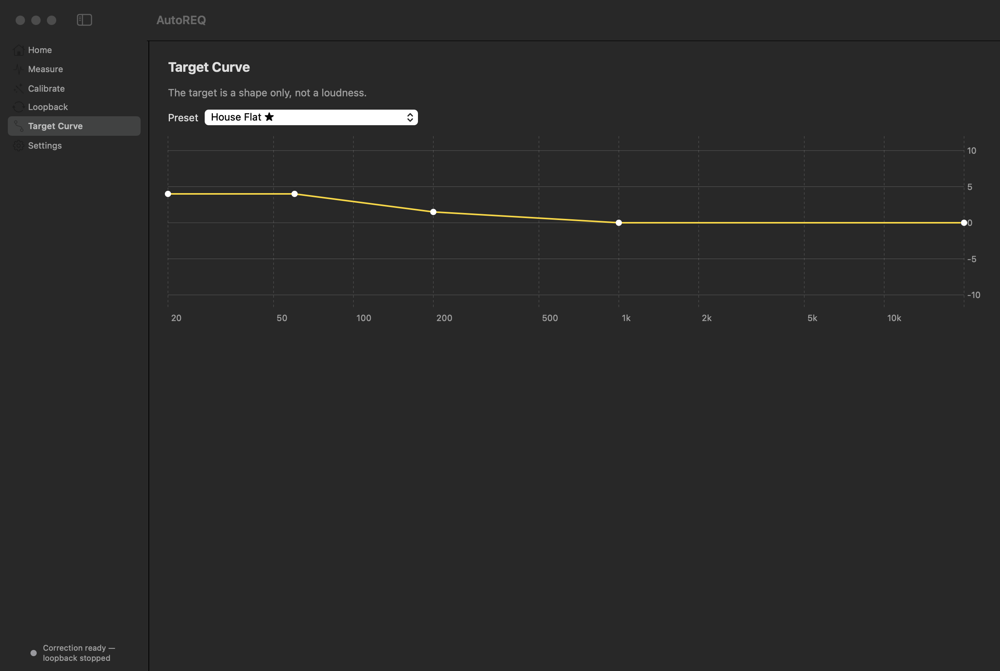

# AutoREQ

AutoREQ is a room-correction app for macOS. It measures your speakers in your room. It then
calculates a correction and applies the correction live to the audio of your Mac.

AutoREQ rebuilds the software features of the Omnissiah app by Tantrum Audio in Swift. AutoREQ is
an independent project. Tantrum Audio does not make, support or endorse it. AutoREQ does not control
the Tantrum Really Mean Sub, because the USB protocol of that device is not public.

## Screenshots

The screenshots show a simulated room with a stereo pair and a subwoofer.

The Measure screen compares the snapshots of the three speakers. It shows the magnitude, the coherence and the phase.



The Spectrum screen shows an RTA in 1/3-octave bands with a peak hold, and a spectrograph. In
the spectrograph, the pink noise starts after 8 s of room noise.



The results page shows each channel after the correction, with the target curve as a dashed line.



The Room Analysis screen shows the impulse response and the energy-time curve. It lists the
reflections and the room modes.



The Loopback screen sets the devices, the volume and the trim of each speaker.



The Target Curve screen shows the selected preset or your custom curve.



## Features

- **Measure:** The app plays a test signal and shows the transfer function of the speaker. The
  chart shows the magnitude, the phase and the coherence. You can keep snapshots and compare them.
  You can also export a snapshot to CSV and import a CSV again.
- **Transfer function tools:** The transfer function uses long windows in the bass and short
  windows in the treble (FTW). Up to 8 mics of one interface measure at the same time. The delay
  tracker follows the delay when the mic moves. A reference snapshot, a phase delay and a capture
  timer are also available.
- **Generator:** The generator plays pink noise, white noise or periodic pink noise. It also plays
  a sine tone, a dual sine or an audio file. The level is an RMS level in dBFS. Presets keep the signal, the
  level and the output channel.
- **Spectrum:** The RTA shows the spectrum of up to 8 inputs in bands from 1/1 octave to 1/48
  octave. It has the averaging modes of the Measure screen and a peak hold. The spectrograph
  shows the last 10 s to 5 min as a color map.
- **Calibrate:** A guided procedure measures each speaker at one or more mic positions. The app
  then calculates the crossover, the level, the delay, the polarity and up to 48 EQ filters for
  each speaker.
- **Room analysis:** The app shows the impulse response and the energy-time curve (ETC) of a
  measurement. It lists the reflections in the first 100 ms with the delay, the level and the
  extra path length. It also lists the room modes from 15 Hz to 300 Hz with the frequency, the
  level, the Q and the decay time (T60).
- **Sweep measurement:** A log sweep gives a 2 s impulse response and the harmonic distortion. The
  app shows EDT, T20, T30, C50, C80 and D50 in octave bands or 1/3-octave bands. It also shows Ts
  and the direct-to-reverberant ratio. You can compare impulse responses, and export or import
  them as WAV files.
- **Target curves:** Five preset curves are available. You can also make a custom curve from
  points.
- **Loopback:** The app captures the system audio from a virtual audio device. It applies the
  correction and sends the result to your speakers. A master volume, a correction strength and a
  trim for each speaker are available.
- **Mic calibration:** The app reads REW and miniDSP calibration files. The app also includes
  approximate curves for the bottom mic of the iPhone 17 Pro and the iPhone 18 Pro.
- **Export:** The app writes REW filter files, corrected-response CSV files and a results file.

## Requirements

- The app needs macOS 15 or later.
- You need a measurement microphone. A USB mic such as the miniDSP UMIK-1 is the easiest choice.
- For the loopback correction, you need a virtual audio device such as BlackHole 2ch or VB-Cable.

## Install

1. Download `AutoREQ.zip` from the latest release on GitHub.
2. Unzip the file, and move `AutoREQ.app` to the Applications folder.
3. Control-click `AutoREQ.app`, and select **Open**.

> **Caution:** The app has an ad-hoc signature only. Apple has not notarized it. macOS blocks
> the first start until you open the app with Control-click → **Open**.

When the app measures for the first time, macOS asks for access to the microphone. Click
**Allow**.

## Build from source

You need Xcode 16 or later.

```bash
git clone https://github.com/strikeout/autoREQ.git
cd autoREQ
swift test
./scripts/bundle.sh
open build/AutoREQ.app
```

The script `scripts/bundle.sh` writes the app to `build/AutoREQ.app`. Use the bundle, not
`swift run`. macOS gives microphone access only to an app bundle.

### Make the screenshots again

The app can draw its main screens with the simulated room and write PNG files. This mode
uses no audio device, and it does not change your saved settings.

```bash
./scripts/bundle.sh
open -W build/AutoREQ.app --args --screenshots "$PWD/docs/screenshots"
```

## Use the app

### Set the devices

1. Open **Settings → Audio**.
2. Select the measurement mic and its input channel.
3. If you have a calibration file for your mic, click **Import calibration file…**.
4. Select the speaker output device.
5. Select the sample rate. The app sets the mic and the output device to this rate.

### Measure a speaker

> **Warning:** The default test signal is pink noise at −20 dBFS RMS. Its peaks are about 13 dB
> higher. Set your amplifier to a low volume before you start the generator.

1. Open **Measure**.
2. Select the signal and the output channel of the speaker.
3. Click **Start**.
4. Wait until the status shows "OK — Measuring".
5. Click **Take Snapshot**, or use **Auto Capture**. Auto Capture stops when the reading is stable.

### Compare and repeat measurements

- Click the star of a snapshot to make it the reference. The chart then shows every other trace
  relative to the reference. Click the star again to remove the reference.
- Set **Phase delay** to move the time reference of the live phase. **Find** sets it to the peak
  of the impulse response, so the phase of the direct sound is flat. A new snapshot keeps the
  phase delay as its delay offset.
- Click **Timer** to take a snapshot at a set interval. The timer can add the average of all
  captures as one snapshot.
- In the settings of the Measure screen, **Track Delay** follows the delay of each mic. Turn it on
  when you move the mic during a measurement.

### Use several mics

1. Connect the mics to one audio interface.
2. Open **Settings → Audio → Extra Mics**, and turn on the input channel of each extra mic.
3. Select a calibration file for each extra mic.

The Measure screen shows one live trace for each mic. **Take Snapshot** keeps one snapshot for each
mic. In the guided calibration, each mic counts as one position. Three mics and 3 positions then
need one round only.

### Select a test signal

- Pink noise is the default signal. It has the same energy in each octave.
- Periodic pink noise repeats every 1.4 s. The impulse response is then exact, so the Room
  Analysis screen needs fewer averages.
- An audio file lets you measure with music. The transfer function is correct only where the
  music has energy, so check the coherence.
- A sine tone or a dual sine is for the RTA. A tone gives no transfer function.

If the level is too high for the signal, the generator shows "Peaks clip". Decrease the level until
the warning goes away.

### Use the spectrum screen

1. Open **Spectrum**.
2. In **Inputs**, select one or more input channels of the mic device.
3. Select the band width and the averaging mode.
4. Turn on **Peak hold** to keep the highest level of each band. Click **Reset** to clear it.
5. Start the generator if you want a test signal. The RTA also works with music or room noise.

The levels are in dBFS. The app does not know the absolute sound pressure level yet. Pink noise at
−20 dBFS RMS reads about −36 dB in each 1/3-octave band.

### Calibrate the room

1. Open **Calibrate**.
2. Select **Quick Measurement** or **Complete Measurement**.
3. Select a system template, and set the output channel of each speaker.
4. Click **Start Measurement**, and follow the steps on the screen.
5. On the results page, click **Apply to loopback**.

### Analyze the room

1. Measure a speaker on the **Measure** screen for at least 5 s.
2. Click **Take Snapshot**.
3. Open **Room Analysis**, and select the snapshot.
4. Select a time span for the charts.

To measure with a sweep:

1. Open **Room Analysis**.
2. In **Measure with a log sweep**, select the output channel, the length and the number of sweeps.
3. Click **Measure**. The app keeps one snapshot for each mic.
4. Select the new snapshot. The page then shows the decay and clarity table and the distortion.

A longer sweep and more repeats give more range above the room noise. A decay time shows only
when its band has enough range.

A reflection 1 ms to 5 ms after the direct sound often comes from the desk, the floor or a near
wall. Absorption or a different speaker position can decrease it. EQ cannot remove a reflection.

The T60 from Q is the decay time of a resonance with the measured Q. The measured T60 comes from
the impulse response in a 1/3-octave band. A mode with a long decay sounds boomy. EQ decreases
its level, but the room keeps some of the decay.

### Use the loopback correction

1. Install a virtual audio device, for example BlackHole 2ch.
2. In **System Settings → Sound → Output**, select the virtual device.
3. In AutoREQ, open **Loopback**.
4. Select the virtual device as the loopback input, and select your speakers as the output.
5. Click **Start**.

The loopback correction runs only while AutoREQ runs. If you close the window, the app continues
to run. Use **Bypass** to compare the sound with and without the EQ. The bypass keeps the
crossover and the levels, so the comparison stays level-matched.

## Mic calibration

Most measurement mics come with a calibration file for each serial number. Download the file for
your mic from the maker, and import it. Examples are miniDSP for the UMIK-1 and UMIK-2, and Dayton
Audio for the EMM-6 and UMM-6. No maker publishes a generic file for these mics, so AutoREQ does not
include one.

The built-in iPhone curves come from graphs that Faber Acoustical published. The values are
approximate and cover 30 Hz to 5 kHz only. If you use an iPhone as the mic over Continuity, set
**Mic Mode → Standard** in the menu bar. Voice Isolation removes steady noise and makes the
measurement wrong.

## Check the measurement chain

A loop-through device sends its output back to its input. Examples are VB-Cable and BlackHole.
The self-test measures such a device against itself.

```bash
open -W --stdout /tmp/selftest.txt build/AutoREQ.app --args --selftest "VB-Cable"
cat /tmp/selftest.txt
```

A correct chain shows a flat response near 0 dB and a coherence near 1. The last line is `PASS`
or `FAIL`.

## Known limits

- The input device and the output device must run at the same sample rate.
- Set a virtual audio device to 48 kHz. At 44.1 kHz, VB-Cable reads 6 dB low at 15 kHz, and
  the measurement and the correction are wrong in the treble.
- The loopback path does not correct clock drift between two devices. The app resets the read
  position when the drift becomes too large, and this can make a click.
- The extra mics must be on the first 8 input channels of the mic device. Mics on different
  interfaces have separate clocks. An aggregate device can drift, so use one interface.
- In the treble, the short window of the FTW treats late reflections as noise. The coherence there
  is then lower than with one long window.
- The calibration does not include a phase correction pass or extra listening areas.
- The crossover is always a 4th-order Linkwitz-Riley filter.
- The live impulse response is about 0.7 s long. Use a sweep for a decay longer than about 0.5 s.
  The sweep impulse response is 2 s long, so it cannot measure a decay longer than about 1.5 s.
- The RTA uses one FFT of 16384 samples. Below about 40 Hz, a band of 1/24 or 1/48 octave is
  narrower than one FFT bin. Adjacent bands then show the same level.
- The generator plays the first 5 minutes of an audio file only.
- Only live measurements have an impulse response. An imported CSV file has none. For such a
  file, the app shows no reflections and no measured decay.

## License

AutoREQ is free software under the GNU General Public License v3.0. See `LICENSE`.
